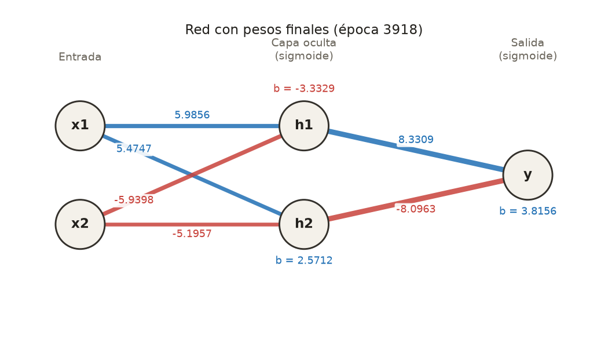
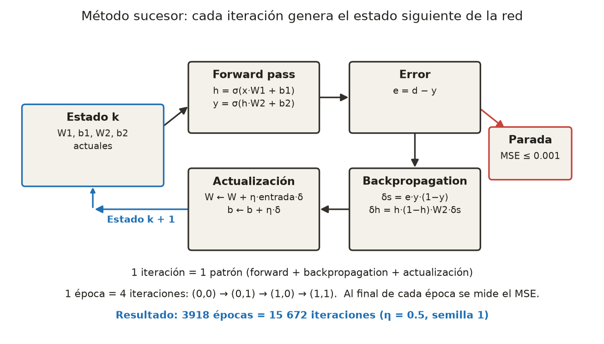
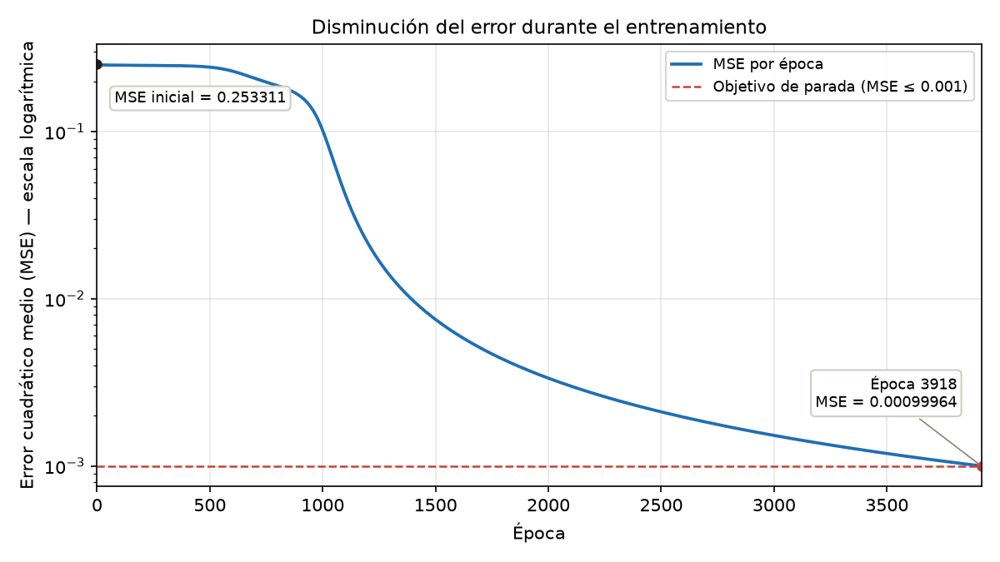
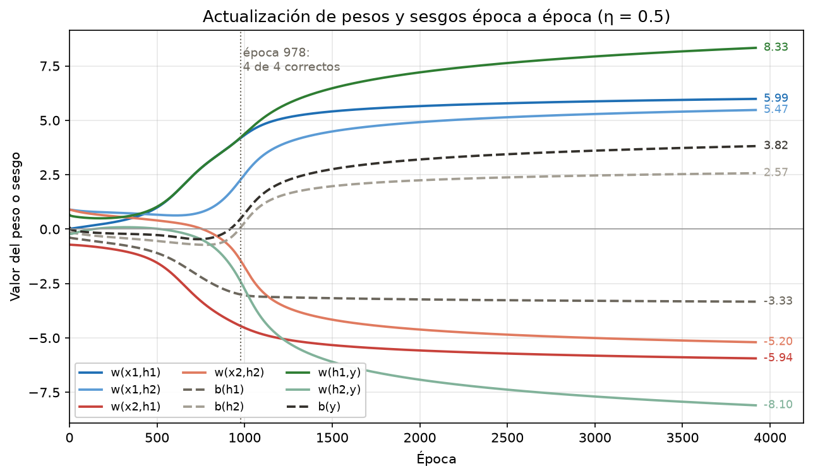
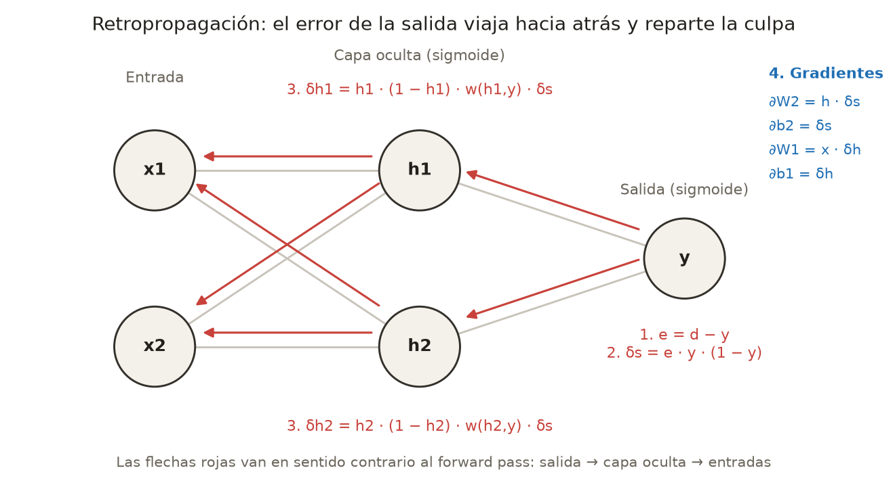

# Parte B: retropropagación, actualización de pesos y método sucesor

Rama: `integrante-b-backprop-video`

Universidad Militar Nueva Granada · Ingeniería en Multimedia · Inteligencia Artificial · 2026-2

---

## Código de la parte B

| Archivo | Qué hace |
|---|---|
| `src/backprop.py` | Retropropagación del error, cálculo de gradientes y actualización de pesos y sesgos con la tasa de aprendizaje |

| Función | Qué calcula |
|---|---|
| `derivada_sigmoide(salida)` | s · (1 − s), a partir de la salida ya activada |
| `delta_salida(salida_deseada, salida_final)` | δs = (d − y) · y · (1 − y) |
| `delta_oculta(delta_de_salida, pesos_salida, salida_oculta)` | δh = h · (1 − h) · (W2 · δs) |
| `gradientes(entrada, salida_oculta, delta_de_salida, delta_de_oculta)` | Gradientes de W1, b1, W2 y b2 |
| `backpropagation(...)` | Une todo y devuelve los pesos y sesgos actualizados |

`backpropagation` respeta la firma acordada con la parte C (`docs/aportes/parte_c.md`): `entrenamiento.py` la llama una vez por patrón con lo que devuelve el `forward_pass` de A, y recibe `pesos_oculta, sesgos_oculta, pesos_salida, sesgo_salida` ya corregidos. La función no modifica los arreglos que recibe: devuelve arreglos nuevos.

### Verificación

- **Gradiente numérico.** Con los pesos iniciales y el patrón (0,1), la corrección de cada peso coincide con −η · ∂E/∂w calculado por diferencias finitas sobre E = ½ (d − y)². La diferencia máxima fue 1.5 × 10⁻¹¹.
- **Entrenamiento completo.** Con la configuración por defecto de la parte C (`python src/main.py --resultados`) la red converge en 3918 épocas, los mismos valores que aparecen en las conclusiones de la parte C.

---

## 3. Estado final

Configuración: red 2-2-1, sigmoide en la capa oculta y en la salida, η = 0.5, pesos iniciales uniformes en [−1, 1] con semilla 1, orden secuencial, actualización en línea, parada en MSE ≤ 0.001.

### a. Matriz final de pesos

**W1: pesos de la capa oculta** (filas = entradas, columnas = neuronas ocultas)

| | h1 | h2 |
|---|---|---|
| x1 | 5.985607 | 5.474725 |
| x2 | −5.939778 | −5.195661 |

**b1: sesgos de la capa oculta**

| h1 | h2 |
|---|---|
| −3.332875 | 2.571202 |

**W2: pesos de la capa de salida** (filas = neuronas ocultas)

| | y |
|---|---|
| h1 | 8.330891 |
| h2 | −8.096275 |

**b2: sesgo de la salida**

| y |
|---|
| 3.815574 |

Comparación con el estado inicial:

| Parámetro | Inicial | Final | Cambio |
|---|---|---|---|
| w(x1,h1) | 0.02 | 5.985607 | +5.965607 |
| w(x1,h2) | 0.90 | 5.474725 | +4.574725 |
| w(x2,h1) | −0.71 | −5.939778 | −5.229778 |
| w(x2,h2) | 0.90 | −5.195661 | −6.095661 |
| b(h1) | −0.38 | −3.332875 | −2.952875 |
| b(h2) | −0.15 | 2.571202 | +2.721202 |
| w(h1,y) | 0.66 | 8.330891 | +7.670891 |
| w(h2,y) | −0.18 | −8.096275 | −7.916275 |
| b(y) | 0.10 | 3.815574 | +3.715574 |

### b. Diseño de la red neuronal con pesos finales

Las conexiones azules son pesos positivos y las rojas negativos; el grosor indica la magnitud. Con estos pesos:

| Entrada (x1,x2) | Salida deseada | h1 | h2 | Salida final y | Clase (umbral 0.5) |
|---|---|---|---|---|---|
| (0,0) | 0 | 0.0345 | 0.9290 | 0.031717 | 0 ✔ |
| (0,1) | 1 | 0.0001 | 0.0676 | 0.963357 | 1 ✔ |
| (1,0) | 1 | 0.9342 | 0.9997 | 0.970814 | 1 ✔ |
| (1,1) | 0 | 0.0360 | 0.9453 | 0.028249 | 0 ✔ |

h1 solo se activa con la entrada (1,0) y h2 solo se apaga con la entrada (0,1). La neurona de salida suma h1 con peso positivo y h2 con peso negativo: así responde 1 cuando las entradas son distintas y 0 cuando son iguales. Cada neurona oculta traza una recta distinta en el plano (x1, x2) y la salida combina las dos, lo que una sola recta no puede hacer.

---

## 6. Método sucesor

El entrenamiento se plantea como una búsqueda en el espacio de pesos. Un **estado** es el conjunto de los 9 parámetros de la red (W1, b1, W2, b2). El **método sucesor** es la regla que genera el estado siguiente a partir del actual: se presenta un patrón, se hace el forward pass, se calcula el error, se retropropaga y se corrigen pesos y sesgos con la regla delta generalizada:

W(k+1) = W(k) + η · entrada · δ  b(k+1) = b(k) + η · δ

El sucesor no se elige al azar ni probando alternativas: el gradiente indica la dirección en la que el error baja más rápido y η fija el tamaño del paso. El estado inicial es la matriz de pesos aleatorios (sección 2) y el estado objetivo es cualquier conjunto de pesos con MSE ≤ 0.001.

- **Iteración:** una aplicación del método sucesor, es decir, un patrón presentado a la red (forward pass + backpropagation + actualización).
- **Época:** los 4 patrones del XOR presentados una vez, es decir, 4 iteraciones. El MSE se mide al terminar cada época.

### a. Cantidad de iteraciones para finalizar el entrenamiento

**15 672 iteraciones** (3918 épocas × 4 patrones).

### b. Cantidad de épocas para finalizar el entrenamiento

**3918 épocas**, momento en el que el MSE llegó a 0.00099964 y se cumplió el criterio de parada MSE ≤ 0.001.

### c. Tabla de iteraciones y épocas

| Momento del entrenamiento | Época | Iteración (épocas × 4) | MSE al final de la época |
|---|---|---|---|
| Inicio (pesos iniciales) | 0 | 0 | 0.253311 |
| MSE baja de 0.2 | 740 | 2 960 | 0.199948 |
| La red clasifica bien los 4 patrones | 978 | 3 912 | 0.119097 |
| MSE baja de 0.1 | 1 003 | 4 012 | 0.099235 |
| MSE baja de 0.01 | 1 393 | 5 572 | 0.009976 |
| **Parada: MSE ≤ 0.001** | **3 918** | **15 672** | **0.000999638** |

**Explicación.** Las iteraciones siempre son 4 veces las épocas porque el entrenamiento es en línea con 4 patrones. Durante las primeras ~500 épocas el MSE casi no baja (pasa de 0.253 a 0.243): la red responde alrededor de 0.5 para todo y los gradientes son pequeños. Entre las épocas 500 y 1400 las neuronas ocultas se especializan, el error cae rápido y desde la época 978 la red ya clasifica bien los 4 patrones. Las 2 940 épocas siguientes (de la 978 a la 3 918, el 75 % del entrenamiento) no cambian la clasificación: solo acercan las salidas a 0 y 1 hasta cumplir el MSE objetivo. Como la derivada de la sigmoide se hace pequeña cuando la salida se acerca a 0 o 1, cada corrección es cada vez menor.

La cantidad de épocas depende de la tasa de aprendizaje. Con la misma semilla y el mismo orden de ingreso:

| η | Épocas | Iteraciones | MSE final | Resultado |
|---|---|---|---|---|
| 0.25 | 50 000 | 200 000 | 0.125192 | Mínimo local, 3 de 4 correctos |
| 0.5 | 3 918 | 15 672 | 0.000999638 | Converge |
| 1.0 | 1 947 | 7 788 | 0.000999500 | Converge |
| 2.0 | 1 029 | 4 116 | 0.000998900 | Converge |

Duplicar η reduce las épocas casi a la mitad cuando la red converge, pero un η muy pequeño puede dejar la red atrapada en un mínimo local; por eso existe el límite de 50 000 épocas.

---

## 7. Estrategia de entrenamiento

### c. Actualización de pesos y sesgos

Después de calcular los deltas (sección 7.d), cada peso se corrige en la dirección contraria al gradiente del error, multiplicada por la tasa de aprendizaje η:

| Parámetro | Gradiente (dirección de corrección) | Regla de actualización |
|---|---|---|
| W2 (oculta → salida) | h · δs | W2 ← W2 + η · h · δs |
| b2 (sesgo de la salida) | δs | b2 ← b2 + η · δs |
| W1 (entrada → oculta) | x · δh | W1 ← W1 + η · x · δh |
| b1 (sesgos de la capa oculta) | δh | b1 ← b1 + η · δh |

El sesgo se actualiza como un peso cuya entrada vale siempre 1. El signo + aparece porque el error se define como e = d − y: el gradiente de E = ½ e² respecto a un peso es −entrada · δ, y restar un gradiente negativo equivale a sumar η · entrada · δ.

**Tasa de aprendizaje (η = 0.5).** Fija el tamaño del paso. Un η grande avanza más rápido pero puede oscilar; uno muy pequeño avanza lento y puede quedarse en un mínimo local (tabla de la sección 6.c).

**Actualización en línea.** Los pesos se corrigen después de cada patrón, no al final de la época. Por eso el patrón (0,1) ya se evalúa con los pesos corregidos por el patrón (0,0).

**Ejemplo: primera iteración (patrón (0,0), d = 0) con los pesos iniciales.**

1. Forward pass: h1 = σ(−0.38) = 0.406127, h2 = σ(−0.15) = 0.462570, y = σ(0.406127 · 0.66 + 0.462570 · (−0.18) + 0.10) = σ(0.284781) = 0.570718.
2. Error: e = 0 − 0.570718 = −0.570718.
3. Deltas: δs = −0.570718 · 0.570718 · 0.429282 = −0.139825; δh1 = 0.406127 · 0.593873 · 0.66 · (−0.139825) = −0.022258; δh2 = 0.462570 · 0.537430 · (−0.18) · (−0.139825) = 0.006257.
4. Actualización con η = 0.5:

| Parámetro | Antes | Corrección η · entrada · δ | Después |
|---|---|---|---|
| w(h1,y) | 0.66 | 0.5 · 0.406127 · (−0.139825) = −0.028393 | 0.631607 |
| w(h2,y) | −0.18 | 0.5 · 0.462570 · (−0.139825) = −0.032340 | −0.212340 |
| b(y) | 0.10 | 0.5 · (−0.139825) = −0.069913 | 0.030087 |
| b(h1) | −0.38 | 0.5 · (−0.022258) = −0.011129 | −0.391129 |
| b(h2) | −0.15 | 0.5 · 0.006257 = 0.003129 | −0.146872 |
| W1 (los 4 pesos) | sin cambio | 0.5 · 0 · δh = 0 | sin cambio |

Como la salida (0.57) era mayor que la deseada (0), todas las correcciones empujan y hacia abajo. Los pesos de W1 no cambian en esta iteración porque las dos entradas valen 0: una conexión solo se corrige cuando su entrada participó en el error.

La gráfica muestra los 9 parámetros al final de cada época. Durante las primeras ~500 épocas cambian poco; alrededor de la época 1000 se separan con rapidez (la red aprende el XOR) y luego cambian cada vez más despacio hasta los valores finales de la sección 3.

### d. Retropropagación del error (Backpropagation)

La retropropagación reparte el error de la salida entre todas las conexiones de la red, empezando por la última capa y avanzando hacia la entrada. Se aplica la regla de la cadena: el efecto de un peso sobre el error pasa por la neurona a la que llega y por todas las que vienen después.

1. **Error de la salida:** e = d − y.
2. **Delta de la salida:** δs = e · y · (1 − y). El factor y · (1 − y) es la derivada de la sigmoide escrita con su propia salida: σ'(z) = σ(z) · (1 − σ(z)). Por eso no hace falta guardar z; basta con lo que devuelve el forward pass.
3. **Delta de cada neurona oculta:** δh_j = h_j · (1 − h_j) · w(h_j,y) · δs. Cada neurona oculta recibe una parte del error de la salida proporcional al peso que la une con ella: si su peso es grande, tuvo más responsabilidad en el error. Este paso usa W2 **antes** de actualizarlo.
4. **Gradientes:** con los deltas se obtienen las correcciones de la sección 7.c (h · δs para W2, x · δh para W1, y los deltas solos para los sesgos).

| Paso | Fórmula | Forma en el código |
|---|---|---|
| Error | e = d − y | (1,) |
| Delta de salida | δs = e · y · (1 − y) | (1,) |
| Delta oculta | δh = h · (1 − h) · (W2 · δs) | (2,) |
| Gradiente W2 | h ⊗ δs (producto exterior) | (2, 1) |
| Gradiente W1 | x ⊗ δh (producto exterior) | (2, 2) |

**Relación con el MSE.** La parte C mide el MSE = (1/4) · Σ (d − y)² al final de cada época para decidir cuándo parar. Para corregir los pesos se usa el error de un solo patrón, E = ½ (d − y)²; el factor ½ solo simplifica la derivada (∂E/∂y = −(d − y)) y su efecto queda absorbido en η.

**Desvanecimiento del gradiente.** Como y · (1 − y) vale como máximo 0.25, el delta se reduce al pasar por cada sigmoide. Esto explica la meseta del inicio y que las últimas épocas corrijan tan poco: cuando las salidas están cerca de 0 o 1, la derivada es casi cero.
